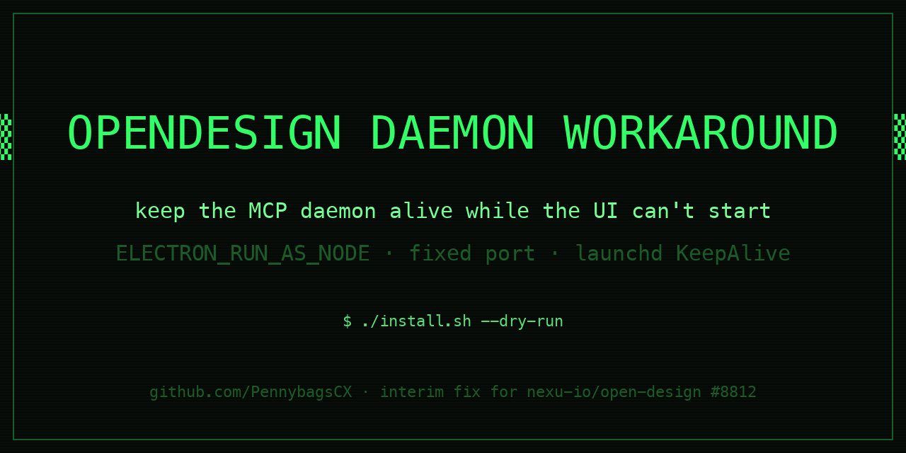

# opendesign-daemon-workaround



Keep the OpenDesign daemon sidecar alive on a fixed port so MCP / CLI clients
keep working — even when the OpenDesign desktop app itself cannot start.

This is an **interim, community workaround** for the startup failures tracked
upstream in [nexu-io/open-design#8812](https://github.com/nexu-io/open-design/issues/8812)
and [#9261](https://github.com/nexu-io/open-design/issues/9261). It is not
affiliated with or endorsed by the OpenDesign project. When upstream ships a
fix, remove this and go back to the normal app.

## The failure modes (why this exists)

On macOS (observed on macOS 27.2, OpenDesign 0.26.1, launcher `channels/stable`):

1. **launchd LaunchAgent cold start** — the app dies with a controlled exit 1:
   `sandbox_extension_issue_file_to_process failed … (Operation not permitted)`
   for the launcher payload, the daemon sidecar's unix socket is never created,
   and `waitForBootstrappedSidecarReady` gives up. With `KeepAlive=false` the
   app then stays down until the next login.
2. **Interactive launch** — `open -a "Open Design"` returns 0, the launcher
   stamps its run, but the UI shuts down cleanly within ~10 s (exit 0) while
   the run's daemon API port never serves.

Both are **Electron-initialization failures**. The Node daemon underneath
(`daemon-cli.mjs` / `daemon-sidecar.mjs`) is unaffected: run in
`ELECTRON_RUN_AS_NODE` mode it binds and serves HTTP normally, with no sandbox
extension, no GPU process, and no helper-app resolution.

## How this workaround works

A launchd agent starts the newest installed payload's daemon in pure-Node mode:

```
ELECTRON_RUN_AS_NODE=1 "Open Design Helper" daemon-cli.mjs \
  --no-open --host 127.0.0.1 --port 7456
```

- `RunAtLoad` + `KeepAlive` → survives reboots and restarts on crashes.
- Fixed port → MCP clients can bind to it (or discover it by process scan).
- The desktop UI is **not** started and **not** fixed — this is an MCP-only
  interim path until [#8812](https://github.com/nexu-io/open-design/issues/8812)
  is resolved upstream.

## Requirements

- macOS with the OpenDesign launcher layout
  (`~/Library/Application Support/Open Design/launcher/channels/stable/…`)
  and at least one installed payload version.
- `bash`, `curl`, `lsof` (all stock macOS).
- A client that speaks MCP against the daemon (e.g. an MCP bridge using
  `daemon-cli.mjs mcp`), or anything that can call its HTTP API.

## Install

```bash
git clone https://github.com/PennybagsCX/opendesign-daemon-workaround.git
cd opendesign-daemon-workaround
./install.sh --dry-run        # preview the plan, touches nothing
./install.sh                  # generate + load the launchd agent, start daemon
```

If the stock desktop app keeps failing at every login and you want it to stop
trying (its `LaunchAgent` uses `KeepAlive=false`, so each failure leaves it
down anyway):

```bash
./install.sh --disable-broken-agent
```

## Start / stop / status

```bash
./opendesign-supervisor.sh status     # is the daemon listening?
./opendesign-supervisor.sh restart
./opendesign-supervisor.sh stop
```

The launchd agent owns the daemon in normal operation (auto-start at login,
auto-restart on crash); the supervisor is for manual control and works with it
(both target the same fixed port, default `7456`, override with
`OD_DAEMON_PORT`).

## Uninstall / restore

```bash
./uninstall.sh                            # stop + remove the workaround agent
./uninstall.sh --reenable-stock-agent     # also re-enable the stock LaunchAgent
```

Restoring the stock desktop agent manually:

```bash
launchctl enable gui/$(id -u)/ai.open-design.desktop.stable
launchctl load ~/Library/LaunchAgents/ai.open-design.desktop.stable.plist
```

## Notes and caveats

- `GET /` on the daemon returns an HTML error page — the API lives on specific
  routes; use your MCP bridge or the documented daemon API instead.
- This runs a third-party app's bundled daemon outside its supported launch
  path. It changes nothing inside the app payload, and `uninstall.sh` removes
  everything it added.
- Verified against OpenDesign 0.26.1 on macOS 27.2 (Nov 2026). If upstream
  changes the launcher layout (`channels/stable/namespaces/release-stable`),
  `install.sh` will tell you it cannot find the payload.

## License

MIT — see [LICENSE](LICENSE).

---

Maintained by [@PennybagsCX](https://github.com/PennybagsCX). If this helped
you, a 👍 on
[#8812](https://github.com/nexu-io/open-design/issues/8812) helps the upstream
fix land faster.
